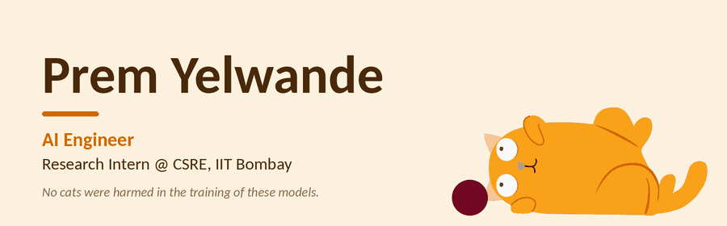

   

---

## About

Third-year B.Tech IT student at VIT Mumbai, specializing in AI/ML. I build backend systems and LLM applications with Python and FastAPI.

Currently a research intern at CSRE, IIT Bombay, using satellite data to study Himalayan glacier hazards. Yes, it's a big jump from "make the button red."

## Tech

  
  
  
  
  
  
  
  
  
  

- **Languages:** Python, Java, SQL
- **Backend:** FastAPI, REST APIs, Pydantic, SQLAlchemy, JWT/OAuth2, async, pytest, Playwright
- **Databases:** PostgreSQL, MySQL, Redis, ChromaDB, PGVector
- **ML/DL:** Scikit-learn, TensorFlow, Keras, XGBoost, OpenCV, Hugging Face, CNNs, transfer learning, fine-tuning
- **LLMs & Agents:** LangChain, LangGraph, RAG, tool calling, multi-agent systems, embeddings, guardrails, MCP
- **AI APIs:** OpenAI, Gemini, Mistral, Sarvam AI, Whisper, Tavily
- **DevOps:** Git/GitHub, Docker, Render

## Research

**Himalayan Hanging Glacier Dynamics** · CSRE, IIT Bombay
Working with Sentinel (Copernicus) satellite data to classify hanging glaciers using DEM-based slope analysis, map glacier velocity, and assess flood hazard from glacier detachment.

## Projects

- **Autonomous AI Software Engineer** – A LangGraph pipeline where planner, architect and coder agents turn a task into working code. Small edits skip straight to the coder agent to save API calls. [Live Demo](#)

## Contact

[LinkedIn](https://www.linkedin.com/in/prem-yelwande/) · [Email](mailto:premyelwande1105@gmail.com)
